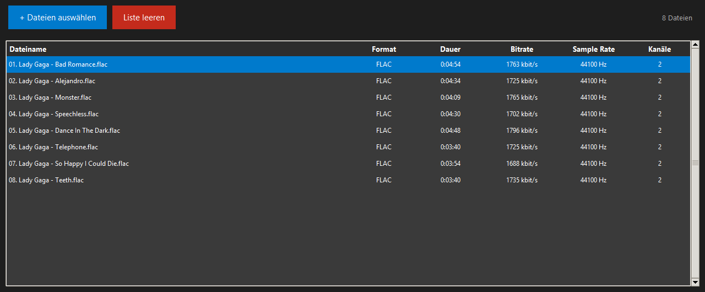
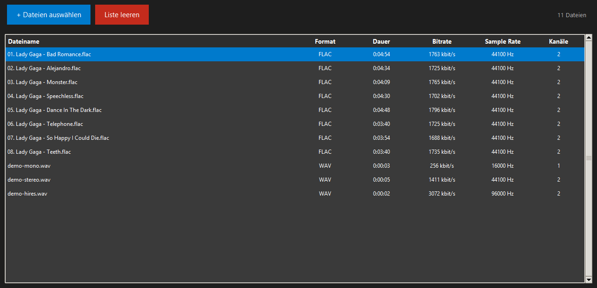

# Audio Analyzer by JStudios

[](https://jstudios.pages.dev/projects/audio-analyzer/)
[](https://www.python.org/)
[](https://docs.python.org/3/library/tkinter.html)
[](https://jstudios.pages.dev/projects/audio-analyzer/)
[](LICENSE)

**Technische Audiodaten im direkten Vergleich.**

[Projektseite](https://jstudios.pages.dev/projects/audio-analyzer/) · [Lizenz](LICENSE) · Bestandsprojekt

Ein schlankes Desktop-Werkzeug, um lokale Audiodateien gemeinsam zu betrachten: Dateiname, Format, Laufzeit, Bitrate, Abtastrate und Kanalzahl in einer Tabelle.

## Hintergrund

Wer größere Musikbibliotheken verwaltet, möchte technische Unterschiede erkennen, ohne jede Datei einzeln in einem Player zu öffnen. Audio Analyzer konzentriert sich auf genau diese Aufgabe. Anders als Lyrics Merge verändert es keine Tags und bietet keine spektrale Tiefenanalyse.

## Vorschau

### Musikbibliothek



*Acht lokal gelesene FLAC-Dateien von Lady Gaga; ausschließlich Dateinamen und technische Werte.*

## Funktionsumfang

### Mehrere Dateien, eine Ansicht

Der Dateidialog erlaubt Mehrfachauswahl. Die Liste wächst mit jeder Auswahl; eine Schaltfläche setzt die gesamte Anzeige zurück.

### Technische Angaben

TinyTag liest Dauer, Bitrate, Abtastrate und Kanalzahl. Dateiname und Endung kommen aus dem Pfad; die Endung ist kein unabhängiger Codec-Nachweis.

### Fehler sichtbar machen

Fehlende Metadaten erscheinen als Strich. Kann TinyTag eine Datei nicht lesen, erscheint eine Fehlerzeile statt eines unbemerkten Auslassens.

## Beispiel und Bedienung

Die echte Qobuz-Auswahl zeigt acht Titel von Lady Gaga aus The Fame Monster: beispielsweise Bad Romance mit 1.763 kbit/s und 44.100 Hz. Drei synthetische WAV-Dateien ergänzen den Vergleich: 16 kHz Mono, 44,1 kHz Stereo und 96 kHz Stereo. Die Daten stammen aus der tatsächlichen Anwendungsausgabe; acht FLAC-Dateien wurden vor und nach dem Test per SHA-256 verglichen.

1. **Dateien wählen:** Lokale MP3-, WAV-, FLAC-, OGG-, M4A- oder WMA-Dateien auswählen. Die tatsächliche Formatunterstützung hängt von TinyTag ab.
2. **Daten gegenüberstellen:** Die Tabelle zeigt die einzelnen Werte; Spaltenbreiten können mit der Maus angepasst werden.
3. **Ansicht zurücksetzen:** Liste leeren, ohne die Musikdateien zu löschen oder zu verändern.

### Formatvergleich



*Dieselben FLACs und drei synthetische WAV-Dateien mit verschiedenen Abtastraten.*

## Technische Eckdaten

Python · Tkinter/ttk · TinyTag

| Bereich | Beschreibung |
| --- | --- |
| Dauer | Auf ganze Sekunden formatierte Laufzeit |
| Bitrate | Von TinyTag gemeldete Bitrate in kbit/s, als Ganzzahl dargestellt |
| Sample Rate | Abtastfrequenz in Hz |
| Kanäle | Anzahl der Audiokanäle |
| Dateiformat | Dateiendung, keine unabhängige Codec-Prüfung |

## Installation unter Windows

Python und pip installieren (für Desktop-Anwendungen zusätzlich Tkinter).

```powershell
git clone https://github.com/byJStudios/audio-analyzer.git
cd audio-analyzer
python -m venv .venv
.venv\Scripts\python.exe -m pip install -r requirements.txt
.venv\Scripts\python.exe audio_analyzer.py
```

Alternativ das Repository als ZIP herunterladen und entpacken. Keine realen Daten in den Repository-Ordner einchecken.

## Projektstatus, Datenschutz und Grenzen

Keine Klangqualitätsbewertung, Bit-Tiefenanzeige oder Spektralanalyse. Unterschiedliche Bitraten bedeuten nicht automatisch unterschiedliche wahrgenommene Qualität. Der Start, WAV/FLAC-Ausgabe und das Leeren der Liste sind geprüft; andere Formate und Plattformen nicht vollständig. Keine Musikdateien, Cover oder privaten Pfade im Repository.

## Lizenz

Du kannst dieses Werkzeug im Rahmen der [PolyForm Noncommercial License 1.0.0](LICENSE) für die dort definierten Zwecke nutzen, den Quellcode nachvollziehen, daraus lernen und ihn entsprechend der Lizenz verändern oder weitergeben. Das Projekt ist Source-Available, nicht OSI-Open-Source. Bereits wirksam gewährte Rechte bleiben unberührt.

Drittkomponenten behalten ihre jeweiligen Lizenzen: TinyTag (MIT). Sie werden separat installiert; die neue Lizenz beansprucht keine Rechte an Drittsoftware, Marken oder Inhalten Dritter. JStudios-Branding und eigene Gestaltungselemente sind nicht pauschal zur Nutzung freigegeben.

Alle nicht eingeräumten Rechte bleiben den jeweiligen Rechteinhabern vorbehalten. Für eine Nutzung außerhalb der bestehenden Lizenz, etwa für nicht abgedeckte kommerzielle Zwecke, kannst du JStudios kontaktieren: [jstudios.development@gmail.com](mailto:jstudios.development@gmail.com).

© 2026 Julian Schmitz / JStudios
